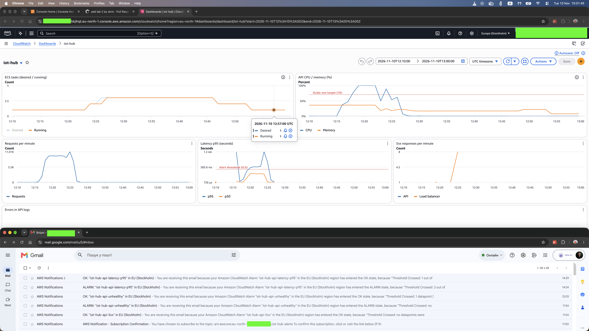

# Alerts

Email alert про перевантаження сервісу: перший лист — коли latency надто висока, другий — коли
вона повертається до норми.

Terraform: [`deploy/aws/terraform/monitoring.tf`](../deploy/aws/terraform/monitoring.tf).

## Умова

**Latency p95 понад 500 мс протягом 2 хвилин поспіль.**

| Параметр       | Значення                                    | Змінна                  |
|----------------|---------------------------------------------|-------------------------|
| Метрика        | `TargetResponseTime` (`AWS/ApplicationELB`) |                         |
| Статистика     | p95 за хвилину                              |                         |
| Поріг          | > 500 мс                                    | `alert_latency_p95_ms`  |
| Тривалість     | 2 послідовні хвилинні точки (2 з 2)         | `alert_latency_minutes` |
| Немає даних    | вважається нормою (`notBreaching`)          |                         |
| Канал доставки | SNS-тема `iot-hub-alerts` → email           | `budget_email`          |

### Чому latency

- **Вона описує те, що відчуває користувач.** Повільна відповідь — це і є проблема; CPU лише
  одна з її можливих причин. Latency зросте й тоді, коли вузьке місце — база даних або зовнішній
  сервіс, а CPU лишається низьким.
- **CPU > 70 % дублював би масштабування.** Це та сама межа, за якою політика додає задачі
  ([AUTOSCALING.md](AUTOSCALING.md)), тож лист приходив би за кожного штатного масштабування,
  навіть коли користувачі нічого не помічають. Такий alert швидко починають ігнорувати.
- **Досягнення максимуму задач** — корисний, але пізній сигнал: він означає лише, що запасу
  масштабування більше немає. Під load test сервіс доходив до 3 задач із 4, тож ця умова не
  спрацювала б.
- **500 мс** — поріг сценарію навантаження з [LOADTEST.md](LOADTEST.md): у нормі p95 становить
  десятки мілісекунд, а понад 500 мс запити вже стоять у черзі насиченої задачі.

### Чому «протягом 2 хвилин»

Одна повільна хвилина (сплеск, запуск нової задачі, cold cache) ще не перевантаження. Вимога
двох точок поспіль відсікає поодинокі сплески й зменшує flapping — чергування ALARM/OK на межі
порогу, коли кожна зміна стану надсилає лист. Довше вікно (5–10 хвилин) ще надійніше від шуму,
але затримує перший лист на той самий час.

## Як працює

- `aws_cloudwatch_metric_alarm.api_latency_p95` щохвилини оцінює latency p95 за даними load
  balancer. Дві хвилини поспіль понад 500 мс → стан **ALARM**, і `alarm_actions` публікує
  повідомлення в SNS-тему. Перша хвилина нижче порогу → стан **OK**, і `ok_actions` публікує
  друге повідомлення.
- `aws_sns_topic.alerts` і `aws_sns_topic_subscription.alerts_email` (протокол `email`, адреса —
  `budget_email`) доставляють обидва повідомлення листами. Після `terraform apply` AWS надсилає
  лист із підтвердженням підписки; доки її не підтверджено, листи не доставляються.
- Без трафіку метрики немає, і `treat_missing_data = "notBreaching"` вважає це нормою: простій
  уночі не є перевантаженням.
- На dashboard графік «Latency p95» має лінію порогу 500 мс (Alert threshold), тож момент
  перетину видно поруч із CPU і кількістю задач.

## Прогін

Load test `loadtest/results/20261110T121622Z` (N = 100, target 70 %), 10 листопада. Зверху —
dashboard за 12:10–13:00 **UTC**; знизу — вхідні листи в Gmail, де час показано **за Києвом**
(UTC+2 у листопаді): 14:24 і 14:29 за Києвом — це 12:24 і 12:29 UTC. Усі часи в таблиці — UTC.



| Момент                        | Час      | Примітка                                                              |
|-------------------------------|----------|-----------------------------------------------------------------------|
| Початок load test             | 12:16:22 | `setup` (≈ 50 с), далі наростання 0 → 100 до 12:20:15                 |
| Початок сталого навантаження  | 12:20:15 | 100 VU; одна задача на CPU 100 % з 12:19                              |
| p95 перевищує 500 мс          | 12:20    | хвилинні p95: 556, 593, 589, 606, 1171, 781 мс (12:20–12:25)          |
| Alarm переходить у ALARM      | 12:24:19 | «Threshold Crossed: 2 out of the last 2 datapoints»                   |
| Перший лист (ALARM)           | 12:24    | 14:24 за Києвом; `ALARM: "iot-hub-api-latency-p95" in EU (Stockholm)` |
| Scale-out                     | 12:23:32 | desired 2; desired 3 о 12:25:32                                       |
| p95 повертається нижче 500 мс | 12:26    | 84 мс (навантаження спадає, 2 задачі)                                 |
| Alarm переходить у OK         | 12:29:19 |                                                                       |
| Другий лист (OK)              | 12:29    | 14:29 за Києвом; `OK: "iot-hub-api-latency-p95" in EU (Stockholm)`    |

**Час від початку сталого навантаження до першого листа — ≈ 4 хвилини** (12:20:15 → 12:24:19).
Друга хвилина понад порогом (12:21) закінчилася о 12:22:00; ще ≈ 2 хвилини 20 с пішло на
публікацію хвилинної точки load balancer у CloudWatch і на оцінювання alarm. Лист прийшов у ту
саму хвилину, що й зміна стану. Другий лист прийшов через ≈ 3 хвилини після першої «нормальної»
хвилини (12:26) з тих самих причин.

Під час прогону load balancer повернув 10 відповідей 502 (1 о 12:19, 1 о 12:23, 8 о 12:25 — під
час реєстрації нових задач): це проблема keep-alive, виправлена в `src/server.js`, але ще не
розгорнута. Звіт k6: 85 210 запитів, помилок 0,01 %, latency p50 / p95 / p99 —
249 / 636 / 1035 мс.

## Час реакції

Від початку перевантаження до листа минає **≈ 4 хвилини** (у прогоні вище — 4 хвилини 4 с):

1. **Вікно alarm — 2 хвилини.** Потрібні дві повні хвилинні точки понад порогом.
2. **Затримка метрик — ≈ 1 хвилина.** Load balancer публікує хвилинну точку в CloudWatch після
   завершення хвилини.
3. **Оцінювання alarm — до 1 хвилини.** CloudWatch перевіряє alarm раз на хвилину.
4. **Доставка — секунди.** SNS надсилає лист одразу; далі — затримка поштового сервісу.

**Чи прийнятно це для реального сервісу.** Для черговості (on-call) ≈ 4 хвилини — нормальний
час: людині все одно потрібні хвилини, щоб відреагувати, а autoscaling за цей час уже додає
задачі (у цьому прогоні scale-out о 12:23:32 — ще до листа; див.
[AUTOSCALING.md](AUTOSCALING.md)). Лист тут — сигнал, що автоматика не встигає або не допомагає,
а не заміна їй. Скоротити час можна метриками з високою роздільністю (10 с) і умовою на кшталт
«3 з 5 точок», але ціною частіших хибних спрацювань. Для критичних сервісів пошта — надто
повільний канал: краще PagerDuty, Slack або SMS через ту саму SNS-тему.

## Перевірка

```sh
cd deploy/aws/terraform
terraform apply
aws cloudwatch describe-alarms --alarm-names iot-hub-api-latency-p95 \
  --query 'MetricAlarms[0].[StateValue,Threshold,EvaluationPeriods]'
aws sns list-subscriptions-by-topic --topic-arn "$(aws sns list-topics \
  --query "Topics[?ends_with(TopicArn, ':iot-hub-alerts')].TopicArn" --output text)"
# після тесту — історія змін стану
aws cloudwatch describe-alarm-history --alarm-name iot-hub-api-latency-p95 \
  --history-item-type StateUpdate --query 'AlarmHistoryItems[].[Timestamp,HistorySummary]'
```

Без load test лист можна перевірити, примусово змінивши стан alarm (CloudWatch поверне його за
наступного оцінювання):

```sh
aws cloudwatch set-alarm-state --alarm-name iot-hub-api-latency-p95 \
  --state-value ALARM --state-reason "manual test"
```
