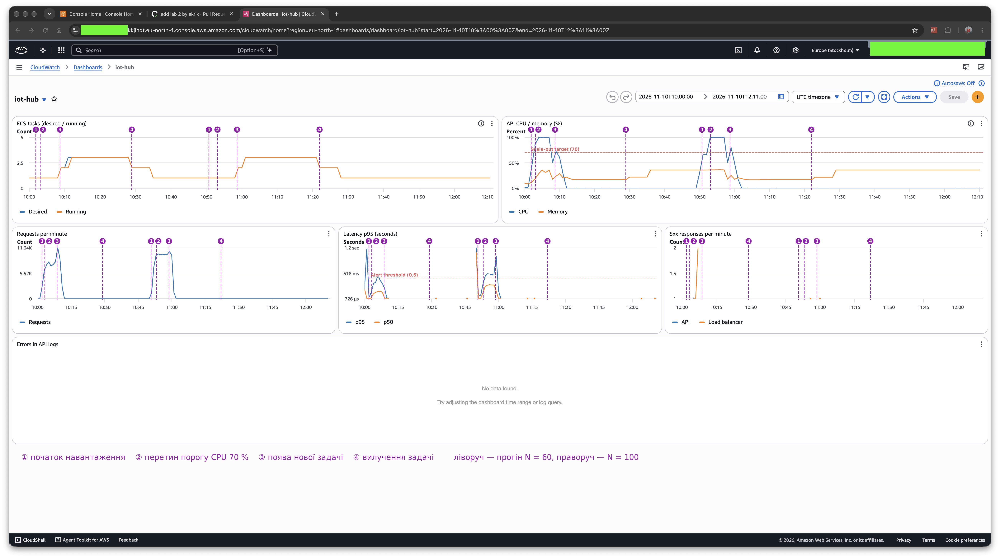

# Autoscaling

API — сервіс ECS Fargate `iot-hub-api` (0,25 vCPU / 512 МБ на задачу) за Application Load
Balancer. Application Auto Scaling змінює кількість задач за політикою target tracking за
середнім CPU.

Terraform: [`deploy/aws/terraform/autoscaling.tf`](../deploy/aws/terraform/autoscaling.tf).

## Параметри

| Параметр                 | Значення                          | Змінна                                |
|--------------------------|-----------------------------------|---------------------------------------|
| Тип політики             | `TargetTrackingScaling`           |                                       |
| Метрика                  | `ECSServiceAverageCPUUtilization` |                                       |
| Цільове значення         | 70 %                              | `autoscaling_cpu_target`              |
| Мінімум / максимум задач | 1 / 4                             | `autoscaling_min` / `autoscaling_max` |
| Cooldown після scale-out | 60 с                              | `autoscaling_scale_out_cooldown`      |
| Cooldown після scale-in  | 300 с                             | `autoscaling_scale_in_cooldown`       |

Під час scale-in ALB ще 30 с дає завершитися поточним запитам (`deregistration_delay`), а
застосунок коректно обробляє `SIGTERM` ([`src/server.js`](../src/server.js)).

### Чому CPU і 70 %

- **CPU.** Кожен запит займає єдиний потік Node.js (JSON, Sequelize, JWT), а задача має лише
  чверть vCPU, тож CPU насичується значно раніше за базу. Найважчий запит — статистика показань
  (`GET /user-devices/:id/readings/stats`): вона читає всі показання за період і агрегує їх у
  JavaScript. Її додано, бо без неї запити були надто легкі: при N = 40 CPU тримався на 50–59 %,
  і масштабування не спрацьовувало.
- **70 %.** Нова задача з'являється через ≈ 5 хв після перетину порогу. Запас 30 % дозволяє
  трафіку зрости ≈ в 1,4 раза за цей час — достатньо для поступового наростання. 80–90 % — уже
  біля межі, де однопотоковий Node ставить запити в чергу і latency різко росте; 30–50 % —
  постійна оплата задач, що простоюють.
- **1–4 задачі.** Без навантаження вистачає однієї; 4 — обмеження лабораторної. Чотири задачі з
  пулом Sequelize по 5 з'єднань — до 20 з'єднань, значно менше за ліміт `db.t4g.micro`.

### Як працює політика

Target tracking сам створює два CloudWatch alarms:

| Alarm       | Умова                                  | Дія             |
|-------------|----------------------------------------|-----------------|
| `AlarmHigh` | CPU > 70 % протягом 3 хвилин поспіль   | додати задачі   |
| `AlarmLow`  | CPU < 63 % протягом 15 хвилин поспіль  | вилучити задачі |

Нова кількість ≈ `ceil(поточна × CPU / target)`: 1 задача на 95 % → `ceil(95 / 70) = 2`.

## Cooldown

Cooldown — пауза після дії масштабування, поки нова задача запуститься і метрика покаже нове
середнє. До того метрика ще каже «перевантажено» (або «простій»).

- **Після scale-out (60 с)** щойно додані задачі вважаються вже наявними: наступний scale-out
  буде, лише якщо потрібно ще більше задач.
- **Після scale-in (300 с)** наступний scale-in чекає 5 хв, тож задачі знімаються по одній.
  Scale-out цей cooldown може перервати: додати потужність швидко безпечніше, ніж прибрати.

**Якщо cooldown = 0**, autoscaler реагує на метрики, які ще не бачать його попередньої дії:

- *Перевищення.* Поки нова задача стартує, CPU ще високий, і кожне оцінювання додає задачі —
  сервіс одразу вискакує до 4, хоча вистачило б 2.
- *Flapping.* Потім CPU падає нижче target, задачі знімаються, CPU росте, задачі додаються.
  Кожен цикл — холодний старт і обірвані з'єднання, тож latency і помилки нестабільні.

## Dashboard

CloudWatch → Dashboards → `iot-hub`;
[`deploy/aws/terraform/monitoring.tf`](../deploy/aws/terraform/monitoring.tf)
(`aws_cloudwatch_dashboard.api`). Точки — щохвилини.

| Графік                        | Метрика                                                          | Статистика  |
|-------------------------------|------------------------------------------------------------------|-------------|
| ECS tasks (desired / running) | `DesiredTaskCount`, `RunningTaskCount` (`ECS/ContainerInsights`) | Maximum     |
| API CPU / memory (%)          | `CPUUtilization`, `MemoryUtilization` (`AWS/ECS`) + лінія 70 %   | Average     |
| Requests per minute           | `RequestCount` (`AWS/ApplicationELB`)                            | Sum         |
| Latency p95 (seconds)         | `TargetResponseTime` + лінія порогу alert 500 мс                 | p95 (і p50) |
| 5xx responses per minute      | `HTTPCode_Target_5XX_Count`, `HTTPCode_ELB_5XX_Count`            | Sum         |

### Прогони

10 листопада, 10:00–12:11 UTC: два прогони з повним циклом scale-out і scale-in — N = 60
(`loadtest/results/20261110T100143Z`) і N = 100 (`20261110T105034Z`, поточна версія сценарію).

На знімку моменти ①–④ позначено пунктирними лініями: ліві чотири — прогін N = 60, праві — N = 100.

| Момент                    | N = 60   | N = 100  | Що видно                                |
|---------------------------|----------|----------|-----------------------------------------|
| ① Початок навантаження    | 10:01:45 | 10:50:34 | запити ростуть (наростання 3 хв)        |
| ② Перетин порогу CPU 70 % | 10:03    | 10:53    | далі CPU 99–100 %, latency p95 росте    |
| ③ Нова задача (desired 2) | 10:08:32 | 10:58:32 | running 2 за хвилину, запитів/хв більше |
| desired 3                 | 10:10:32 | 11:00:32 | уже на спаді — за старими точками       |
| Кінець навантаження       | 10:11:51 | 11:01:28 | запити й CPU падають до нуля            |
| ④ Вилучення (desired 2)   | 10:28:48 | 11:21:48 | ≈ 17–20 хв після кінця навантаження     |
| Повернення до 1 задачі    | 10:34:48 | 11:27:48 | ще +6 хв (cooldown 300 с)               |

### Чому задача з'являється через ≈ 5,5 хв після перетину порогу

1. **Вікно alarm — 3 хв.** `AlarmHigh` чекає 3 хвилинні точки поспіль, щоб короткий сплеск не
   запускав масштабування.
2. **Затримка метрик — 1–2 хв.** ECS публікує CPU в CloudWatch із запізненням, alarm
   оцінюється раз на хвилину.
3. **Запуск задачі — ≈ 1 хв.** Fargate завантажує образ, застосунок стартує, ALB чекає 2 успішні
   health checks (по 15 с).

Увесь цей час одна задача насичена: запитів/хв не більшає, а p95 росте до сотень мс. Другий
scale-out (desired 3) — зворотний бік затримки: політика рахувала за старими точками, хоча
навантаження вже спадало.

### Чому вилучення значно пізніше

- `AlarmLow` чекає **15** хвилинних точок нижче 63 % (90 % від target); ці значення задає AWS.
- Після кожного scale-in — cooldown 300 с, тож задачі знімаються по одній.
- Це навмисно: передчасний scale-in дорожчий (обірвані запити, новий холодний старт при
  наступному сплеску), ніж кілька зайвих хвилин роботи задачі. Асиметрія 3 хв / 15 хв захищає
  від flapping.

Тому до 1 задачі сервіс повертається через ≈ 23–26 хв після тесту; перед наступним прогоном слід
дочекатися `desired = running = 1`.
