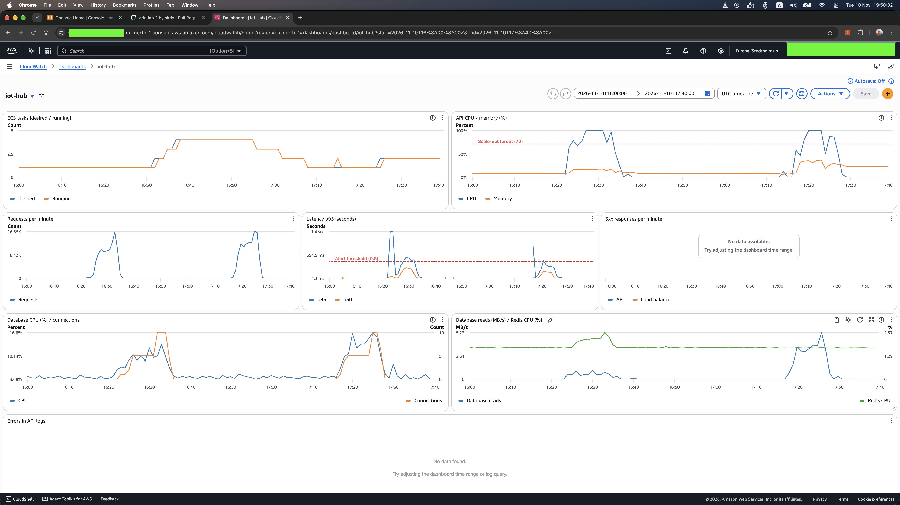

# Cache

Найважча операція читання — статистика показань `GET /user-devices/:id/readings/stats` —
працює за схемою **cache-aside** зі спільним Redis.

Код: [`src/cache.js`](../src/cache.js), [`src/services/readings.js`](../src/services/readings.js).
Terraform: [`deploy/aws/terraform/cache.tf`](../deploy/aws/terraform/cache.tf).

## Що кешується і чому

Статистика читає **всі** показання пристрою за період (у load test — ≈ 1440 + нові) і в
JavaScript рахує count / min / max / avg / p50 / p95 для кожного поля, загалом і по годинах.
Це найдорожчий запит сервісу: локально ≈ 6–9 мс CPU проти ≈ 2 мс для решти, і саме він насичує
CPU задачі під load test ([LOADTEST.md](LOADTEST.md)). Тому кешується саме він.

## Як працює cache-aside

```
GET /user-devices/:id/readings/stats
  1. перевірка власника пристрою — завжди в базі (дешевий запит за первинним ключем)
  2. GET stats:<deviceId>:<bucket>:<period> у Redis
     ├─ є → повернути (X-Cache: HIT)
     └─ немає → прочитати показання з бази, порахувати статистику,
                SET ... EX 60, повернути (X-Cache: MISS)
```

- **TTL 60 с** (`cache_ttl_seconds`, допустимо 30–60). Redis сам видаляє запис після закінчення
  TTL, тож наступний запит знову рахує статистику з бази.
- **Ключ** містить пристрій, інтервал (`hour`/`day`) і період **так, як його передав клієнт**
  (`default..now` для типового «останні 7 днів»). Обчислені межі періоду змінюються щомілісекунди,
  і ключ на їх основі ніколи б не повторився.
- **Перевірка власника — до кешу.** Інакше інший користувач отримав би чужу статистику з кешу:
  кеш не знає, хто запитує.
- **Відповідь має заголовок `X-Cache`**: `HIT`, `MISS` або `OFF` (кеш вимкнено). За ним load test
  рахує частку влучань.
- **Збій Redis не ламає запит.** Помилка Redis записується в журнал, а запит іде в базу, як без
  кешу. Перевірено локально: зупинений Redis → відповіді 200, `X-Cache: MISS`.

## Чому Redis окремим сервісом, а не кеш у пам'яті процесу

Кеш у пам'яті процесу (наприклад, `Map` у Node.js) у кожної задачі свій:

- **Нижча частка влучань.** З 3 задачами той самий пристрій потрапляє на різні задачі, і кожна
  мусить порахувати статистику сама: до 3 промахів замість одного на кожен TTL.
- **Різні відповіді.** Задачі кешують статистику в різні моменти, тож два послідовні запити
  клієнта можуть повернути різні дані — залежно від того, яка задача їх обробила.
- **Порожній кеш після масштабування.** Нова задача стартує з холодним кешем, саме коли
  навантаження найвище.
- **Пам'ять задачі.** Кеш займає ті самі 512 МБ, що й застосунок, і росте без контролю.

Redis — один на всі задачі: перша задача, що порахувала статистику, кладе її в Redis, а решта
читають готову. Він не залежить від масштабування API і має власний ліміт пам'яті з витісненням.

## Інфраструктура

| Ресурс                                            | Призначення                                                         |
|---------------------------------------------------|---------------------------------------------------------------------|
| `aws_ecs_service.redis`                           | `redis:7.4-alpine`, 0,25 vCPU / 512 МБ, одна задача, без збереження |
| `aws_service_discovery_*`                         | DNS `redis.iot-hub.local` у VPC (Cloud Map)                         |
| `aws_security_group.redis`                        | вхід 6379 лише від security group API                               |
| `REDIS_URL`, `CACHE_ENABLED`, `CACHE_TTL_SECONDS` | змінні середовища API з `cache_enabled`, `cache_ttl_seconds`        |

Redis працює лише в пам'яті (`--save ""`, `--appendonly no`) з `--maxmemory 256mb` і
`allkeys-lru`: перезапуск очищує кеш, а за браку пам'яті витісняються найдавніші ключі — для кешу
це нормально. На dashboard додано два графіки: «Database CPU (%) / connections» і
«Database reads (MB/s) / Redis CPU (%)». Database CPU мало змінюється від кешу, бо база тут не
вузьке місце; ефект кешу видно в обсязі даних, які база віддає API (RDS `NetworkTransmitThroughput`).
Redis CPU показує, що Redis працює лише в прогоні з кешем (≈ 1,7 % → 2,1–2,4 %). Пам'ять Redis
на графіку не показано: ≈ 100 ключів по кілька КБ — це ≈ 0,5 % з 512 МБ, лінія була б пласкою.

## Прогони без кешу і з кешем

Кеш вмикається змінною Terraform. Сервіс ігнорує зміни task definition з Terraform, тому після
`apply` нову ревізію треба розгорнути явно:

```sh
cd deploy/aws/terraform
terraform apply -var cache_enabled=false   # або true
aws ecs update-service --cluster iot-hub --service iot-hub-api \
  --task-definition iot-hub-api --force-new-deployment
aws ecs wait services-stable --cluster iot-hub --services iot-hub-api
cd ../../.. && VUS=100 npm run loadtest
```

Перед кожним прогоном слід дочекатися 1 задачі (див. [AUTOSCALING.md](AUTOSCALING.md)).

Обидва прогони — 100 VUs, профіль із [LOADTEST.md](LOADTEST.md), 10 листопада 2026 (UTC).
CPU, пам'ять і база — середні за 2 хв на сталому навантаженні, до появи другої задачі.

| Показник                                | Без кешу                                                    | З кешем                                                     |
|-----------------------------------------|-------------------------------------------------------------|-------------------------------------------------------------|
| Прогін                                  | [`20261110T171717Z`](../loadtest/results/20261110T171717Z/report.md), 17:17–17:28 | [`20261110T162422Z`](../loadtest/results/20261110T162422Z/report.md), 16:24–16:35 |
| Запитів усього / за секунду             | 113 470 / 174,3                                             | 97 210 / 145,9                                              |
| Latency p50 / p95 / p99                 | 117 / 371 / 519 мс                                          | 184 / 537 / 759 мс                                          |
| Latency p95 `GET …/readings/stats`      | 407 мс                                                      | 487 мс                                                      |
| Помилки                                 | 0,00 %                                                      | 0,00 %                                                      |
| CPU API                                 | 100 % (1 задача)                                            | 100 % (1 задача)                                            |
| Пам'ять API                             | ≈ 33 %                                                      | ≈ 18 %                                                      |
| Максимум задач ECS                      | 2                                                           | 4 (після спаду навантаження)                                |
| Database CPU                            | 13–16 %                                                     | 9–12 %                                                      |
| **Читання з бази** (NetworkTransmitThroughput) | **3,3–4,2 МБ/с**                                     | **0,5–0,7 МБ/с**                                            |
| Database connections                    | 5–10                                                        | 5–10                                                        |
| Частка влучань у кеш (stats)            | —                                                           | 92,1 %                                                      |



### Що показують прогони

**Кеш знімає навантаження з бази.** Статистика читає всі показання пристрою за період, тож без
кешу кожен такий запит тягне з бази ≈ 1440+ рядків. З кешем 92 % запитів статистики бази не
торкаються: з бази читається в **5–6 разів менше даних** (графік «Database reads» на dashboard),
Database CPU нижчий на ≈ 4 п.п. Пам'ять API з кешем удвічі менша: задача не тримає в пам'яті
тисячі рядків на кожен запит статистики, а отримує з Redis готовий JSON.

**Пропускна здатність і latency в цих прогонах визначаються не кешем.** В обох прогонах вузьке
місце — CPU однієї задачі API (100 %), а база завантажена лише на 10–16 %. Прогін без кешу
обробив на ≈ 20 % більше запитів, але причина — задача, а не кеш: ендпоінти, яких кеш не
стосується, з кешем були повільніші в тій самій мірі (`GET /devices` p50: 156 мс з кешем,
93 мс без кешу — у 1,7 раза). Той самий код працював повільніше, отже, повільнішою була сама
задача. Перемикання `CACHE_ENABLED` потребує нової задачі, а Fargate може запустити її на іншому
хості з іншою продуктивністю CPU. Ця різниця більша, ніж економія від кешу (≈ 15 % CPU, див.
нижче), тому вона й визначила результат. З тієї ж причини прогін із кешем довше тримав CPU вище
target і autoscaler додав задачі вже після спаду навантаження (до 4).

**Ефект кешу на CPU — у контрольованому порівнянні.** Щоб прибрати вплив хоста, обидва режими
прогнано локально на одній машині з однією базою: 30 VUs, 1 хв сталого навантаження, однакова
кількість запитів.

| Локально, 30 VUs            | Без кешу      | З кешем       |
|-----------------------------|---------------|---------------|
| Запитів                     | 8141          | 8221          |
| Stats: середнє / p95        | 7,6 / 11 мс   | 2,6 / 8 мс    |
| Інші читання: середнє       | 2,2 мс        | 2,2 мс        |
| CPU сервера за прогін       | 21,8 с        | 18,6 с (−15 %) |

Статистика з кешем утричі швидша, а сервер витрачає на ≈ 15 % менше CPU на той самий обсяг
роботи. На одній і тій самій задачі це дало б ≈ 15 % більше запитів до масштабування. У цьому
профілі статистика — лише 1 запит з 10, тому виграш у CPU помірний; основний ефект — розвантаження
бази, яка в реальному сервісі спільна для всіх задач і не масштабується так просто, як API.

**Частка влучань 92,1 %** відповідає очікуваній: кожен VU читає статистику свого пристрою раз
на ітерацію, а запис живе 60 с — один промах на пристрій щохвилини. За ≈ 10 хв прогону це
≈ 97 запитів статистики на пристрій, з них ≈ 8–10 промахів (перший запит і раз на TTL).

## Застарілі дані

Кеш не інвалідується під час запису: нове показання (`POST /ingest`) не змінює вже закешовану
статистику. Тому **після запису клієнт може бачити застарілу статистику до 60 с** (TTL):
найгірший випадок — запис одразу після того, як статистику закешовано.

Як зменшити цей час:

- **Коротший TTL** (30 с — нижня межа завдання): удвічі менше застарівання, але й удвічі більше
  промахів і запитів до бази.
- **Інвалідація під час запису.** `POST /ingest` видаляє ключі статистики пристрою (`DEL` або
  номер версії пристрою в ключі, який запис збільшує). Застарівання зникає, але в цьому load test
  кожен VU пише у свій пристрій перед кожним читанням, тож кеш скидався б щоітерації і частка
  влучань упала б майже до нуля. Для профілю «рідкі записи, часті читання різними
  користувачами» це добрий вибір.
- **Оновлення під час запису (write-through).** Запис одразу перераховує й кладе статистику в
  кеш: читання завжди свіжі, але кожен запис стає дорожчим.

Для статистики за 7 днів застарілість у хвилину непомітна для користувача, тому тут обрано
простий TTL без інвалідації.

## Cache stampede

Коли популярний запис закінчується, багато одночасних запитів отримують промах і всі разом
ідуть у базу. У цьому сервісі ризик малий: ключі — по одному на пристрій, і кожен читає один VU.
Для спільних «гарячих» ключів допомагають блокування на перерахунок (`SET key NX` — рахує лише
один запит, решта чекає або бере старе значення), випадковий розкид TTL (jitter) і
попереднє оновлення запису до закінчення TTL.
