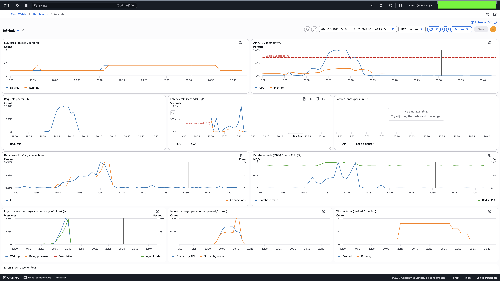

# Queue

Запис показань `POST /ingest` іде через чергу **Amazon SQS**: сервіс перевіряє запит, кладе
показання в чергу і відповідає `202 Accepted`, а окремий контейнер-обробник (**worker**) читає
чергу і записує показання в базу. Worker масштабується від довжини черги.

Код: [`src/queue.js`](../src/queue.js), [`src/routes/ingest.js`](../src/routes/ingest.js),
[`src/services/readings.js`](../src/services/readings.js) (`acceptReadings`, `storeReadings`),
[`src/ingest-worker.js`](../src/ingest-worker.js), [`src/worker.js`](../src/worker.js).
Terraform: [`deploy/aws/terraform/queue.tf`](../deploy/aws/terraform/queue.tf).

## Як це працює

```
пристрій ── POST /ingest ──▶ API ── SendMessage ──▶ SQS iot-hub-ingest ── Receive ──▶ worker ──▶ PostgreSQL
            ◀── 202 + id ──   │                         │        ▲                       │
                              │                         │        └──── Delete ───────────┘
                              │                         └─ 5 невдалих спроб ──▶ iot-hub-ingest-dlq
```

1. **API** перевіряє `X-Device-Key` (запит до бази за хешем ключа) і тіло запиту, дає кожному
   показанню `id` (UUID) і `createdAt` (момент прийняття), відправляє **одне повідомлення на
   запит** (одне показання або пакет до 1000) і відповідає `202` з тими самими `id` /
   `createdAt` та заголовком `Location` — адресою, за якою показання буде доступне. Невірний
   ключ — `401`, невірне тіло — `400`, тіло більше за 256 КБ (ліміт повідомлення) — `413`;
   у жодному з цих випадків повідомлення не відправляється.
2. **Worker** читає чергу long polling (до 10 повідомлень, очікування до 20 с), записує кожне
   повідомлення однією транзакцією і видаляє з черги лише записані. Повідомлення з помилкою
   лишається в черзі й повертається через visibility timeout (30 с); після 5 невдалих спроб
   SQS переносить його в dead-letter queue (DLQ, зберігається 14 днів).
3. Без `INGEST_QUEUE_URL` (локально, тести, `ingest_queue_enabled = false`) API записує
   показання сам і відповідає `201`, як раніше.

| Ресурс                                         | Призначення                                                      |
|------------------------------------------------|------------------------------------------------------------------|
| `aws_sqs_queue.ingest`                         | черга; visibility timeout 30 с, long polling 20 с, зберігання 4 дні |
| `aws_sqs_queue.ingest_dlq`                     | DLQ після 5 спроб, зберігання 14 днів                            |
| `aws_iam_role.api_task` / `worker_task`        | API може лише відправляти, worker — лише читати й видаляти      |
| `aws_ecs_service.worker`                       | той самий образ, команда `node src/worker.js`, 0,25 vCPU / 512 МБ |
| `aws_appautoscaling_policy.worker_backlog`     | target tracking: 1–4 задачі за **backlog per task**              |

**Масштабування worker.** Метрика — кількість повідомлень, що чекають, на одну запущену задачу
(metric math `ApproximateNumberOfMessagesVisible / RunningTaskCount`), target
`worker_backlog_per_task` = 100. Саме довжина черги, а не CPU, показує, чи встигає worker: при
100 повідомленнях на задачу і швидкості ≈ 145 показань/с (виміряно нижче) затримка запису —
менше секунди. CPU worker'а на 100 % може означати і «черга росте», і «рівно встигає».

## Прогін

[`20261110T200228Z`](../loadtest/results/20261110T200228Z/report.md), 10 листопада 2026,
20:03–20:13 UTC: сценарій завдання 2 з 40 VUs і сценарій devices — 50 пристроїв, до
200 показань/с:

```sh
VUS=40 DEVICE_RATE=200 DEVICES=50 npm run loadtest
```



| Показник                                          | Значення                                          |
|---------------------------------------------------|---------------------------------------------------|
| Користувачі: запитів / за секунду                 | 38 650 / 60,6                                     |
| Користувачі: latency p50 / p95 / p99              | 158 / 439 / 885 мс                                |
| `POST /ingest` (користувачі): p50 / p95 / p99     | 172 / 382 / 664 мс                                |
| Devices: показань / за секунду (середнє / стале)  | 86 103 / 135 (≈ 207 на сталому навантаженні)      |
| Devices: latency p50 / p95 / p99                  | 191 / 454 / 1775 мс                               |
| Помилки (обидва сценарії)                         | 0,00 %                                            |
| Один worker: записує / CPU                        | ≈ 145 показань/с (8,4–8,8 тис./хв) / 96–99 %      |
| Максимум у черзі / вік найстаршого повідомлення   | 17 464 (20:09) / 150 с (20:10)                    |
| Задачі worker                                     | 1 → 4 о 20:10, назад до 1 о ≈ 20:28–20:34         |
| Задачі API                                        | 1 → 2 о 20:11, назад до 1 о ≈ 20:36               |
| Database CPU / write latency                      | 15–19 % (28 % під час розвантаження черги) / ≈ 1 мс |
| DLQ                                               | 0                                                 |
| Показання доступне одразу після запису            | 16,5 %                                            |
| Попереднє показання доступне через ітерацію (≈ 5 с) | 31,5 %                                          |

**Хронологія (UTC).**

| Час         | Що відбувається                                                                    |
|-------------|------------------------------------------------------------------------------------|
| 20:00–20:03 | `setup`: користувачі, пристрої, історія через чергу (сплески latency — пакети по 1000) |
| 20:03–20:06 | наростання: devices до ≈ 207 показань/с, користувачі до 40                         |
| 20:05       | надходить більше, ніж записує один worker (≈ 12,4 тис./хв проти ≈ 8,5 тис./хв): черга росте |
| 20:05–20:09 | черга росте до 17,5 тис., найстаршому повідомленню 101 с; latency API p95 — 246–420 мс |
| 20:10       | **worker 1 → 4** одним кроком; 4 задачі записують ≈ 18,5 тис./хв                    |
| 20:11       | черга порожня; API 1 → 2 (CPU 100 % з 20:06)                                       |
| 20:11–20:13 | спад навантаження                                                                  |
| 20:28–20:36 | scale-in: worker 4 → 3 → 2 → 1, API 2 → 1                                          |

## Що показує прогін

**Latency запису не залежить від того, чи встигає база.** Поки черга росла до 17,5 тис.
повідомлень (20:05–20:09), API приймав показання з тією самою швидкістю, а p95 сервісу лишався
246–420 мс (поріг сповіщення — 500 мс). Без черги ці ≈ 60 показань/с, яких worker не встигав
записати, лягли б на запити: кожен запис чекав би транзакції в базі на тій самій задачі API, і
latency очікувано росла б разом із навантаженням на запис (окремого прогону без черги з тим
самим профілем не було). З чергою надлишок записів став довжиною черги, а не часом
відповіді. `POST /ingest` — це перевірка ключа і `SendMessage`; його p95 (382 мс) такий самий,
як у читань, тобто визначається CPU задачі API, а не записом у базу.

**Worker масштабується від довжини черги.** Один worker упирається в CPU (96–99 %) на
≈ 145 показань/с. Коли повідомлень на задачу стало більше за 100, autoscaling додав задачі —
одразу до максимуму 4, бо backlog per task (≈ 17 тис.) у сотні разів перевищував target.
Чотири задачі розібрали чергу за ≈ 1 хв (≈ 300 показань/с, CPU 60–69 %).

**Чому worker додано лише о 20:10, через ≈ 5 хв після початку росту черги.** Складові:
SQS публікує `ApproximateNumberOfMessagesVisible` раз на хвилину із затримкою; alarm
target tracking спрацьовує після 3 хвилинних точок понад target; нова задача Fargate
стартує ≈ 1 хв. За цей час накопичилось 17,5 тис. повідомлень і затримка запису до 2,5 хв.
Для швидшої реакції — нижчий target (повідомлень на задачу), step scaling із більшим кроком
або `worker_min = 2` у години навантаження (завдання 8).

**Scale-in поступовий**: alarm зниження вимагає 15 хвилин backlog нижче 90 % target, далі
задачі знімаються по одній з cooldown 120 с.

### Сплески latency о 20:10–20:11

На графіку latency p95 видно сплеск до 1,9 с:

- **20:10:04–20:10:20** — початкова задача API майже перестала завершувати запити (≈ 4/с
  замість ≈ 300/с) на всіх ендпоінтах, найдовший — 18,4 с. Це збігається зі стартом трьох
  нових worker'ів (20:09:58–20:10:02), які одночасно почали розбирати 17 тис. повідомлень.
  При цьому latency RDS лишалась ≈ 1 мс, пам'ять API ≈ 28 %, помилок у журналах API, worker і
  Redis немає. Найімовірніше — конкуренція за базу (з'єднання / блокування рядків
  `UserDevices`, які оновлюють усі worker'и), але це не доведено; для перевірки варто увімкнути
  Performance Insights RDS і журнал повільних запитів.
- **20:11:32–20:11:52** (до 5,1 с) — холодний старт нової задачі API: ALB почав надсилати їй
  трафік, щойно вона пройшла health check.

Обидва сплески — вже після того, як черга перестала рости, тобто не від прийому записів.

## Що змінилося для клієнта

- **`202 Accepted` замість `201 Created`.** 201 означає «створено», 202 — «прийнято до обробки,
  результату ще немає». Відповідь містить остаточні `id` і `createdAt` показання та
  `Location`, але **в момент відповіді показання ще немає в базі**.
- **Читання одразу після запису може його не побачити** (eventual consistency). У прогоні
  щойно записане показання було доступне лише в 16,5 % випадків, а через ітерацію (≈ 5 с) — у
  31,5 %: поки черга росла, затримка запису сягала 1,5–2,5 хв. Без черги обидві частки — 100 %.
- **`createdAt` — момент прийняття**, а не запису в базу, тож порядок і час показань
  правильні, навіть якщо worker записав їх пізніше.
- **Помилки обробки клієнт не бачить.** Відповідь 202 означає, що показання збережене в черзі,
  а не в базі. Якщо worker не зможе його записати (наприклад, пристрій видалили між прийомом і
  записом), повідомлення після 5 спроб потрапить у DLQ — це видно на dashboard («Dead letter»).

### Як клієнт дізнається результат

- **Опитування `Location`**: `GET /user-devices/:id/readings/:readingId` повертає `404`, доки
  worker не записав показання, і `200` після. Так робить load test. Недолік — 404 не
  відрізняє «ще не записано» від «не існує».
- Кращі варіанти для реального сервісу: окремий ресурс статусу (`GET /ingest/:id` →
  `pending` / `stored` / `failed`), push-сповіщення (webhook, WebSocket) або
  `lastSeenAt` пристрою як «записано до цього моменту».

Для пристрою IoT 202 достатньо: йому треба лише знати, що показання прийняте і не загубиться;
читає показання власник пізніше.

## Доставка «щонайменше один раз»

Стандартна черга SQS гарантує доставку **щонайменше один раз** (at-least-once): повідомлення не
загубиться, але може бути отримане **більше одного разу** і **не в тому порядку**. Повторна
доставка трапляється, коли:

- worker записав показання, але впав (або його зупинив scale-in) до `DeleteMessage`;
- обробка тривала довше за visibility timeout (30 с) — повідомлення знову стало видимим;
- SQS зрідка доставляє копію сама (розподілене зберігання).

Протилежність — **щонайбільше один раз** (at-most-once): видалити повідомлення до обробки;
тоді збій під час обробки губить показання. Черги обирають «щонайменше один раз», бо втрату
даних виправити неможливо, а повтор можна зробити безпечним на боці обробника.

### Що буде при повторній обробці

Повторна обробка безпечна (обробник **ідемпотентний**):

- `id` показання призначає **API** до відправки, тож у кожній копії повідомлення ті самі
  `id`. Worker вставляє з `ON CONFLICT DO NOTHING` (`bulkCreate({ ignoreDuplicates: true })`):
  друга копія нічого не додає.
- `lastSeenAt` пристрою оновлюється як `GREATEST(lastSeenAt, createdAt)`, тож старе
  повідомлення, оброблене пізніше за нове, не відкотить час назад.
- Повідомлення, яке падає щоразу («poison message»), не блокує чергу безкінечно: після 5 спроб
  воно в DLQ.

Обидва випадки перевірені тестами (`test/api/ingest-queue.test.js`: «stores a message
delivered twice only once», «never moves lastSeenAt back when an older message arrives late»).

**Чого черга не розв'язує.** Якщо клієнт не отримав відповідь 202 (обрив з'єднання, таймаут) і
повторив запит, API створить **нові** `id` — і показання запишеться двічі. Захист від цього —
ідемпотентність на вході (`Idempotency-Key`, завдання 7): повтор запиту з тим самим ключем
повертає ту саму відповідь з тими самими `id`, а черга з ідемпотентним worker'ом гарантує, що
кожне прийняте показання записане рівно один раз.
